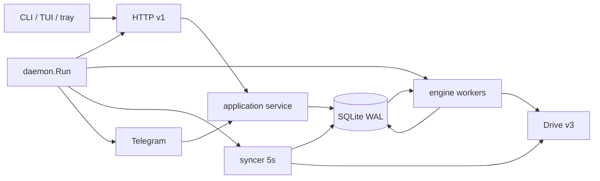

# Kiến trúc

Go 1.27, một module (`github.com/GiaHung07/502Drive`), một binary chính
`502drive` và một wrapper GUI `502drive-tray` cho Windows. Rust/Tauri/React đã
gỡ 2026-10-26 (archive ngoài git); không còn runtime thứ hai.

## Bố cục source

| Đường dẫn | Trách nhiệm |
| --- | --- |
| [cmd/502drive/main.go](../cmd/502drive/main.go) | Entry: signal context → `cli.Execute` |
| [cmd/502drive-tray/main.go](../cmd/502drive-tray/main.go) | Entry GUI (`-H=windowsgui` khi release) |
| [internal/app](../internal/app) | Application service: plan/inspect, admit, job action, sync, prefs, doctor |
| [internal/httpapi](../internal/httpapi) | Router, auth bearer, DTO, lỗi, conformance OpenAPI |
| [internal/cli](../internal/cli) | Commands, HTTP client + stream, menu dòng + TUI, launcher (`up`/bare), tray, logs, autostart |
| [internal/tui](../internal/tui) | Bubble Tea model: realtime, chọn nhiều, cửa sổ danh sách, tốc độ/ETA |
| [internal/mascot](../internal/mascot) | Chú mèo pixel (nửa ô `▀▄`), mood + spring animation; chỉ sinh text |
| [internal/update](../internal/update) | Kiểm tra release mới (chỉ đọc, không cài) |
| [internal/tray](../internal/tray) | State machine, icon, clipboard/terminal/daemon argv, systray |
| [internal/telegram](../internal/telegram) | Inbox bền vững, menu/callback, outbox, notifier |
| [internal/engine](../internal/engine) | Worker copy/delta, intent, claim, finalize |
| [internal/state](../internal/state) | SQLite, migration, transaction, idempotency, outbox |
| [internal/schedule](../internal/schedule) | Schedule spec → slot, DST, preview |
| [internal/drive](../internal/drive) | Provider Drive v3, OAuth PKCE, parse link, drivetest fake |
| [internal/daemon](../internal/daemon) | Wiring store+engine+HTTP+syncer+Telegram, lifecycle |
| [internal/maintenance](../internal/maintenance) | Backup/restore/cleanup offline |
| [internal/config](../internal/config) | Config JSON private, token files |
| [internal/i18n](../internal/i18n) | Bảng chuỗi vi/en cho TUI/menu/tray |

## Luồng chạy

Một process `502drive serve` giữ `instance.lock` cho data dir, mở SQLite
(`state-v2.db`, WAL, `MaxOpenConns=1`), chạy engine (mặc định 2 job × 4 worker),
syncer 5s và (nếu cấu hình) bot Telegram. CLI nghiệp vụ **không** mở DB, chỉ HTTP
([client.go](../internal/cli/client.go)); maintenance là ngoại lệ offline có
kiểm tra lock ([maintenance.go](../internal/maintenance/maintenance.go)).

## Bất biến

- Admission (plan → job + collection + seed root + event + idempotency) commit
  trong một transaction trước khi trả `202` ([jobs.go](../internal/state/jobs.go)).
- Mỗi remote write có intent bền vững; unknown outcome → reconcile/blocked,
  không gửi lặp mù ([run.go](../internal/engine/run.go)).
- Job/plan/collection/sync revision bảo vệ điều khiển; callback Telegram
  one-shot + TTL 15 phút ([state/telegram.go](../internal/state/telegram.go)).
- `HTTP request context` chỉ sống đến response; job dùng context của daemon.
- One writer: mọi ghi đi qua store của daemon; adapter không SQL.
- Không log token/secret/resource key; tên Drive chỉ để hiển thị, identity là ID.

## Đa nền tảng

- Linux/Windows/macOS đều build `CGO_ENABLED=0`; tray dùng `fyne.io/systray`
  (thuần Go trên Linux D-Bus/Windows; macOS không hỗ trợ tray).
- `time/tzdata` được nhúng trong daemon để zone IANA hoạt động trong image tối giản.
- Windows release build thêm `.syso` icon (go-winres) trong hook GoReleaser.

## Không có trong kiến trúc này

- Không SQLite/HTTP phụ, không engine thứ hai, không webview, không sidecar.
- Không migration legacy: data dir Go riêng, `application_id=502002`.
  Chi tiết nâng cấp: [migration](migration.md).

## Tín hiệu thay đổi và vòng đời

- `state.Store` đếm mọi lần ghi thành công (kể cả transaction) qua một bọc mỏng
  quanh `database/sql` ([changes.go](../internal/state/changes.go)). `GET /v1/stream`
  đánh thức theo bộ đếm này; client chỉ nhận "có thay đổi" và tự đọc lại, nên không
  có replay hay trạng thái phía server cho từng client.
- Daemon chạy tách khỏi terminal (`502drive up` / lệnh trần). Chỉ `POST /v1/shutdown`
  (nút Quit của tray) dừng nó; đóng tab, thoát TUI hay Ctrl-C ở client không ảnh
  hưởng. Dừng đi theo thứ tự cũ: ngừng nhận request, engine về điểm an toàn, đóng
  state; job đang chạy tiếp tục ở lần mở sau.
