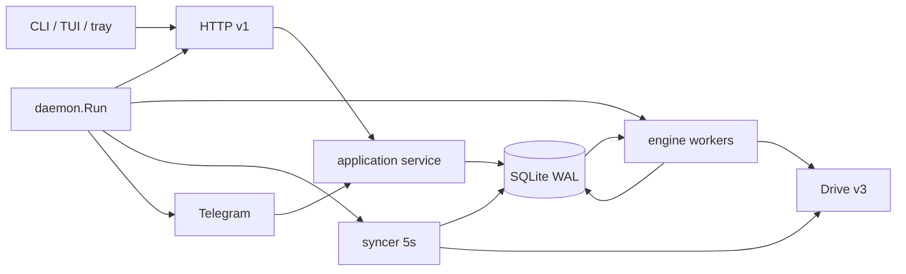

# Kiến trúc

Go 1.27, một module (`github.com/itsgiahung/502Drive`), một binary chính
`502drive` và một wrapper GUI `502drive-tray` cho Windows. Bản Rust/Tauri cũ đã
gỡ 2026-10-26; không còn runtime thứ hai.

## Bố cục source

| Đường dẫn | Trách nhiệm |
| --- | --- |
| [cmd/502drive/main.go](../cmd/502drive/main.go) | Entry: signal context → `cli.Execute` |
| [cmd/502drive-tray/main.go](../cmd/502drive-tray/main.go) | Entry GUI (`-H=windowsgui` khi release) |
| [internal/app](../internal/app) | Application service dùng chung: plan/inspect, admit, job action, queue, lifecycle, sync, audit, prefs, doctor |
| [internal/httpapi](../internal/httpapi) | Router, auth bearer, DTO, lỗi, conformance OpenAPI, SSE |
| [internal/cli](../internal/cli) | Commands, HTTP client + stream, menu dòng + TUI, launcher (`up`/bare), tray, logs, autostart/systemd |
| [internal/tui](../internal/tui) | Bubble Tea model: realtime, chọn nhiều, cửa sổ danh sách, tốc độ/ETA |
| [internal/tray](../internal/tray) | State machine, icon, clipboard/terminal/daemon argv, systray |
| [internal/mascot](../internal/mascot) | Chú mèo pixel; chỉ sinh text |
| [internal/telegram](../internal/telegram) | Inbox bền vững, menu/callback, outbox, notifier, quiet hours |
| [internal/engine](../internal/engine) | Worker copy/delta, intent, claim, finalize, audit/repair/cleanup |
| [internal/state](../internal/state) | SQLite, migration, transaction, idempotency, queue, history, prune |
| [internal/schedule](../internal/schedule) | Schedule spec → slot, DST, preview |
| [internal/drive](../internal/drive) | Provider Drive v3, OAuth PKCE, parse link, throttle AIMD, `drivetest` fake |
| [internal/daemon](../internal/daemon) | Wiring store+engine+HTTP+syncer+Telegram, lifecycle (ngủ/mạng) |
| [internal/maintenance](../internal/maintenance) | Backup/restore/cleanup/prune/vacuum offline |
| [internal/power](../internal/power) | Phát hiện ngủ/thức, mạng đổi, keep-awake (Linux inhibitor/Windows API) |
| [internal/autostart](../internal/autostart) | XDG autostart (Linux), Run key (Windows), systemd `--user` unit |
| [internal/filter](../internal/filter) | Rule lọc S5 (path/name/size/mime), dùng bởi app/engine |
| [internal/present](../internal/present) | Định dạng dùng chung (thời gian, byte, state) cho CLI/TUI/Telegram |
| [internal/live](../internal/live) | Harness test Google thật, build tag `live` |
| [internal/update](../internal/update) | Kiểm tra release mới (chỉ đọc, không cài) |
| [internal/config](../internal/config) | Config JSON private, token files |
| [internal/i18n](../internal/i18n) | Bảng chuỗi vi/en cho TUI/menu/tray/Telegram |

## Luồng chạy

Một process `502drive serve` giữ `instance.lock` cho data dir, mở SQLite
(`state-v2.db`, WAL, `MaxOpenConns=1`), chạy engine (mặc định 2 job × 4 worker,
trần AIMD), syncer 5s và (nếu cấu hình) bot Telegram. CLI nghiệp vụ **không** mở
DB, chỉ HTTP ([client.go](../internal/cli/client.go)); maintenance là ngoại lệ
offline có kiểm tra lock.

## Luồng job

1. **Admission** — `POST /v1/plans` đọc metadata + một trang children (plan TTL
   10 phút; `deep:true` quét nền). `POST /v1/jobs` authorize plan/revision, kiểm
   capacity (`max_active_jobs`, `capacity_exceeded`), rồi commit collection + job +
   seed root + event `admitted` + idempotency **trước** khi trả `202`
   ([jobs.go](../internal/state/jobs.go)). Job đã có bản sao cùng nguồn/đích →
   `already_copied`; `mode=update|new` (L2).
2. **Discovery** — BFS thư mục theo trang, batch nhiều cha (F1); item + checkpoint
   `page_token` ghi cùng transaction. Lọc S5 áp trước khi ghi; mục bị loại
   `skipped/filtered`, thư mục rỗng không tạo.
3. **Copy** — folder → create, file → `files.copy`, shortcut theo chính sách K1;
   giữ tên/cây, N1 xử lý trùng tên bằng `dest_name` đã giữ chỗ. Mọi write có
   `intent_key` bền vững trước khi gọi Drive; unknown outcome → `reconciling`, không
   gửi lặp mù; `blocked` chờ người xử lý.
4. **Finalize** — tính `succeeded/partial/blocked/failed` từ item, ghi
   `result_url`, cập nhật collection; S8 áp `after_copy_sync` cùng transaction.
5. **Reconcile/retry** — `retry` đưa item lỗi về pending, cùng job identity;
   lần khởi động sau đối chiếu item `executing` trước khi ghi.

Chi tiết: [clone-jobs](features/clone-jobs.md), thiết kế trong
[design/](design/) (S6 queue, S7 preflight, N1, K1, S5, S2, Q1).

## Hàng đợi, throttle, quota

- **Hàng đợi công bằng (S6)**: job `queued` chọn theo `queue_priority` (-5..5),
  rồi fair share theo `fair_group` (batch hoặc collection), rồi FIFO
  `queue_order`; index `jobs_queue`/`jobs_fair`. `POST /v1/queue/pause|resume`
  đặt cờ bền `settings.queue_paused`; job đang chạy chuyển `pausing → paused` ở
  điểm an toàn, resume chỉ đánh thức job do queue tạm dừng.
- **Throttle AIMD (S3)**: `workers` 4 → `max_workers` 8; +1 sau
  `throttle_successes` call thành công liên tiếp, halve khi 429. Permit bao quanh
  claim → call → ghi kết quả, nên số item `executing` không vượt trần. Đọc qua
  token bucket `read_requests_per_second`; ghi chỉ chịu AIMD. 429 không đốt
  attempt; `Retry-After` được tôn trọng; `/v1/status.throttle` báo trạng thái.
- **Quota (Q1)**: `copy_ledger(principal,hour,bytes)` ghi cùng transaction
  `CompleteItem`; `dailyLimitExceeded` → job `blocked` với `resume_after` nửa đêm
  Los Angeles; `storageQuotaExceeded` → +24h; item không mất lượt, job giữ id và
  tự chạy lại khi `ResumeDueBlocked` thấy mốc đã qua.

## Audit, repair, cleanup

- **Audit** (S1): job `kind=audit` chỉ đọc, đối chiếu cây nguồn/đích, ghi
  `audits` + `audit_findings` (upsert, restart không nhân đôi). Finding:
  `missing_at_destination`, `extra_at_destination` (không sửa), `name_mismatch`,
  `wrong_parent`, `size_or_md5_mismatch`, `duplicate_at_destination`,
  `source_removed`, `unreadable_source`.
- **Repair**: job riêng tham chiếu audit, dùng đúng đường copy/`align` hiện có,
  chỉ trash bản cũ có `502drive_intent` sau khi bản mới xác nhận (qua
  `item_versions`). Dry-run mặc định ở CLI; chạy lại cho kế hoạch rỗng.
- **Cleanup** (L1): job `kind=cleanup` chỉ đưa thư mục đích do 502Drive tạo vào
  thùng rác Drive (`TrashFile`), cần collection đã retired + `confirm_name`; gọi
  lại khi đã trash là thành công.
- **Collection lifecycle**: `retire` tắt sync/realtime, hủy job chờ, state
  `retired` + `retired_at`; `resume` về ready; `forget` xóa bản ghi cục bộ khi đã
  retired. Không thao tác nào xóa vĩnh viễn trên Drive.

## Sync

- **Scheduled**: `ScheduleSpec` interval/daily/weekly (DST, misfire coalesce);
  `sync_occurrences` chặn chạy lặp; slot giữ due khi queue đầy.
- **Realtime**: poll Drive Changes với cursor/subscription; lọc bằng mapping;
  `AdvancePoll` ghi cursor + admit run cùng transaction. Trong baseline, page được
  lưu vào `sync_pending_changes` (trần 5000 dòng/4 MiB) rồi replay một transaction;
  overflow → `needs_reconcile` + full reconcile. Full reconcile định kỳ
  `full_reconcile_every` (mặc định 7 ngày, 0 tắt) đọc lại cây, không so digest.
- **Delta run**: cùng collection/root/mapping; đổi fingerprint → generation mới;
  move/rename → `align`; mất nguồn → `source_removed`, giữ bản đích; mất >30%
  mapping → dừng trước copy (`partial`, `source_mass_removal`) và tạo audit.

Chi tiết: [automation](features/automation.md), [design/s2-sync-replay.md](design/s2-sync-replay.md).

## Vòng đời máy và daemon

- `internal/power` phát hiện ngủ bằng lệch đồng hồ tường/đơn điệu >30s (logind/
  Power API chỉ phụ); trước khi ngủ ngừng nhận việc (`503 suspending`), checkpoint
  WAL; sau khi thức kiểm DB, probe mạng có backoff rồi mở lại hàng đợi. Lỗi mạng
  không làm item `failed` và không tiêu attempt.
- `GET /v1/stream` chỉ mang bộ đếm thay đổi (mọi write qua `state/changes.go`);
  client tự đọc lại.
- Daemon chạy tách khỏi terminal (`502drive up` / lệnh trần). Chỉ
  `POST /v1/shutdown` (nút Quit của tray) dừng nó; đóng tab, thoát TUI hay Ctrl-C
  ở client không ảnh hưởng. Dừng: ngừng nhận request → engine về điểm an toàn →
  đóng state; job đang chạy tiếp tục ở lần mở sau.

## Bất biến

- Admission commit trước `202`; accepted ≠ succeeded; retry/restart giữ identity.
- Mỗi remote write có intent bền vững; unknown outcome được reconcile, không gửi lặp.
- Revision bảo vệ job/plan/collection/subscription; callback Telegram one-shot +
  TTL 15 phút.
- HTTP request context chỉ sống đến response; job dùng context của daemon.
- One writer: mọi ghi đi qua store của daemon; adapter không SQL.
- Không log token/secret/resource key; tên Drive chỉ để hiển thị, identity là ID.

## Đa nền tảng

- Linux/Windows/macOS đều build `CGO_ENABLED=0`; tray dùng `fyne.io/systray`
  (Linux D-Bus/Windows; macOS không hỗ trợ tray).
- `time/tzdata` được nhúng trong daemon để zone IANA hoạt động trong image tối giản.
- Windows release build thêm `.syso` icon (go-winres) trong hook GoReleaser.

## Không có trong kiến trúc này

- Không SQLite/HTTP phụ, không engine thứ hai, không webview, không sidecar.
- Không migration legacy: data dir Go riêng, `application_id=502002`.
  Chi tiết nâng cấp: [runbooks](runbooks.md#nâng-cấp--rollback).
