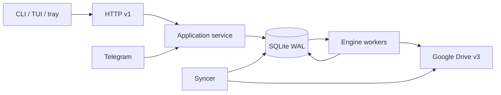

# Architecture

502Drive is a single Go 1.27 module, `github.com/itsgiahung/502Drive`. One daemon
owns the database, workers and tokens. The CLI/TUI/tray use HTTP; Telegram calls
the same application service. There is no second engine, webview or sidecar.

## Package map

| Package | Responsibility |
| --- | --- |
| [cmd/502drive](../cmd/502drive) | CLI entry and signal context |
| [cmd/502drive-tray](../cmd/502drive-tray) | Windows GUI launcher |
| [internal/app](../internal/app) | Shared authorization and application operations |
| [internal/httpapi](../internal/httpapi) | HTTP routes, authentication, DTOs, SSE and conformance |
| [internal/cli](../internal/cli) | Commands, HTTP client, launchers and adapters |
| [internal/tui](../internal/tui) | Bubble Tea model, detail focus and live views |
| [internal/tray](../internal/tray) | Tray state, fixed action arguments and native presentation |
| [internal/telegram](../internal/telegram) | Durable inbox/outbox, cards, callbacks and notifications |
| [internal/engine](../internal/engine) | Discovery, copy, reconciliation, audit, repair and protection jobs |
| [internal/state](../internal/state) | SQLite transactions, migrations, intents, queue and history |
| [internal/drive](../internal/drive) | Drive v3, OAuth, reference parsing, throttle and fake provider |
| [internal/daemon](../internal/daemon) | Service wiring, workers, syncer and lifecycle |
| [internal/schedule](../internal/schedule) | Schedule slots, timezone/DST and preview |
| [internal/maintenance](../internal/maintenance) | Offline backup/restore/prune/vacuum/temporary-file cleanup |
| [internal/power](../internal/power) | Sleep/network detection and optional keep-awake |
| [internal/autostart](../internal/autostart) | Desktop startup and Linux user service |
| [internal/filter](../internal/filter) | Shared selective-copy rules |
| [internal/present](../internal/present) | Shared state, error, size and progress presentation |
| [internal/i18n](../internal/i18n) | English/Vietnamese application strings |
| [internal/config](../internal/config) | Private configuration and token paths |
| [internal/update](../internal/update) | Read-only release checks |
| [internal/live](../internal/live) | Explicitly gated real-provider tests |
| [internal/mascot](../internal/mascot) | Terminal cat rendering |

## Runtime

`serve` holds `instance.lock`, opens `state-v2.db` in WAL mode with one database
connection, and runs engine, syncer, HTTP and optional Telegram. Default job slots
are two; worker permits are shared account-wide. Operational clients never open
SQLite. Offline maintenance is the lock-checked exception.

## Job lifecycle

1. Preview reads metadata and a shallow page; optional deep discovery runs in the
   background. Plans have principal/destination revision and expiry.
2. Admission validates authorization, revision and capacity, then commits job,
   collection/seed as needed, first event and idempotency before returning `202`.
3. Discovery is paginated BFS, optionally batching up to 40 parents. Items and page
   checkpoints commit together. Filters run before writes.
4. Copy records intent before Drive calls. Folder create, server-side file copy
   and supported shortcut handling preserve names/tree. Unknown outcomes reconcile.
5. Terminal state, collection state and bookkeeping marker commit together;
   unfinished bookkeeping replays on startup before new workers.

Retry and restart preserve job/operation identity. Cancel keeps completed output.
No permanent Drive delete exists. See [copy jobs](features/clone-jobs.md).

## Scheduling, throttle and protection

Fair queue order is priority, running work per group, then FIFO. Global queue pause
is durable and does not erase user pauses. Shared AIMD permits limit active work;
a read token bucket paces metadata calls. Rate limits honor Retry-After without
spending attempts. Daily/storage quotas block with explicit resume time and keep
job identity. The local copy ledger measures confirmed logical bytes.

Scheduled subscriptions claim durable slots; realtime subscriptions commit cursor
advance with admission. Baseline Changes buffering has bounded replay and overflow
reconciliation. Full reconcile defaults to seven days. Runs reuse collection/root;
large source disappearance triggers a read-only audit rather than automatic deletion.

Mirror and automatic snapshots are per-collection opt-ins. Mirror requires a clean
scan/copy and exact ownership. Snapshots checkpoint physical-copy mappings and content
identity. Restore is a durable preview-first job; apply pauses sync atomically.
See [automation](features/automation.md) and [protection](features/protection.md).

## Read and repair paths

Audit reads both trees and records findings. Repair reuses normal copy/align paths,
revalidates ownership and trashes superseded copies only after replacements are
confirmed. Snapshots protect referenced versions. Collection cleanup requires
retirement/name confirmation and only trashes an owned root. Forget removes local
metadata while retaining remote files.

## Client and daemon lifetimes

`up` and the interactive launcher detach the daemon. TUI/tray exits do not normally
stop it. Explicit stop uses `POST /v1/shutdown`: refuse new work, reach worker safe
points, close state, then resume unfinished work at next startup. Foreground `serve`
follows its process lifetime.

SSE carries a change counter, not rows; clients re-read their current views.
Detail navigation keeps row focus separate from the selected job/collection and
preserves identity during list reordering.

Sleep detection combines portable clock-gap detection and OS hooks. Before sleep,
admission suspends and WAL checkpoints; wake waits for connectivity. Network errors
do not spend attempts, and uncertain writes still reconcile.

## Invariants and portability

- Accepted is durable, not a claim of success.
- One daemon owns database, credentials and workers.
- All mutations enforce principal scope/revision; callbacks add one-shot expiry.
- HTTP request cancellation does not cancel admitted jobs.
- Drive names are display data; IDs/intents establish identity.
- No credentials/resource keys in logs, public examples or handoffs.
- Linux/Windows/macOS CLI/daemon build without CGO; tray supports Linux/Windows.
- Embedded timezone data supports minimal images. Windows resources are generated
  during release builds, not committed as binaries.

The Go data directory uses `application_id=502002`; legacy runtime state is not
migrated. See [data contracts](data-contracts.md) and the
[upgrade runbook](runbooks.md#upgrade-and-rollback).
