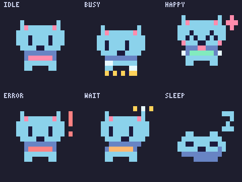

# Mascot 502Drive — chibi sắc nét (2026-10-27)

Hướng đã được người dùng chọn: **nhỏ, ít chi tiết, nét rõ**. Bản trước dùng
supersampling/alpha cho một hình vốn đã rất nhỏ; viền, mắt, râu và highlight
trộn thành nhiều mảng màu khi vào terminal. Không tiếp tục thu nhỏ bitmap đó.




## Quyết định thiết kế

- Vẽ trực tiếp sprite **14×10 pixel**, tai nhọn, mắt đen 1×2 pixel, miệng nhỏ,
  thân ngắn/chân tách rõ, một mức bóng tím và khăn màu mood. Bỏ râu mờ, viền AA,
  ngực nhiều lớp, chuông/highlight nhỏ hơn một pixel.
- Pixel nhân vật chỉ có alpha 0 hoặc 1; tối đa 9 màu/khung. Không resize/phối màu
  giữa hai pixel. Chỉ di chuyển nguyên pixel, chọn pose theo thời gian và spring
  hiện có, không đếm frame. Renderer lớn nhân nguyên 2× cùng sprite.
- `MiniCols = 18` thay 20; `MiniRows = 7` thay 9 ở HEAD (bản soft thử trước
  đó là 11 dòng); `miniY0 = 12` thay 8 ở HEAD.
  Viewport 18×14 pixel chứa nhân vật cùng khoảng trống cho nhảy/đuôi/marker.
  `CompactRows = 6` thay 7, giữ nguyên pixel, chỉ đổi viewport/đặt chân thấp hơn.
- `internal/tui/home.go` vẫn có `catCols = 20`; `centerCell`/`padCell` tự căn giữa
  kết quả rộng 18 cột. Panel lấy chiều cao theo số dòng thực tế. Không sửa TUI.
- Full vẫn 60×13 ô; crop full 34 cột. Strip vẫn 56×4 ô. Giữ mọi chữ ký API,
  `Options.Dark/Profile/Crop/Mini/Compact`, seed, snapshot Frame độc lập và NoMotion
  do caller điều khiển. Không thêm dependency/goroutine.
- Nền sáng làm màu đậm hơn bằng nhánh palette hiện có. ANSI16/256 vẫn dùng
  quantization hiện có; mắt phải khác màu lông trong cả hai profile.

Đối chiếu hình chibi Claude trong ảnh người dùng cung cấp: học silhouette và
khoảng trống quanh mắt. Tham khảo thêm bài chính chủ
[GitHub về animation CLI của Copilot](https://github.blog/engineering/from-pixels-to-characters-the-engineering-behind-github-copilot-clis-animated-ascii-banner/):
nhóm thiết kế dùng frame và palette theo vai trò, chú ý khác biệt terminal.
Ứng dụng ở đây là sprite pixel đơn giản, không chép nhân vật hay thêm toolchain.

## Đọc hành động

| Mood | Dấu hiệu chính |
| --- | --- |
| Idle | Đứng yên, đảo mắt/chớp mắt có seed, đuôi hai pose; thỉnh thoảng ngáp/chải má/vươn |
| Busy | Hai chân trước thay nhau gõ trên hàng phím vàng, đầu/mắt theo nhịp file |
| Happy | Ngồi thấp trước bật lên, giơ hai chân, mắt cười và sao hồng/vàng |
| Error | Dấu ! đỏ, mắt mở lớn rồi bình tĩnh, run đầu giảm dần |
| Wait | Đầu dịch ngang một pixel, mắt nhìn sang, ba chấm vàng/trắng sáng lần lượt |
| Sleep | Silhouette thấp và rộng, mắt nhắm, đuôi cuộn, Z nổi lên |

Mỗi mood có silhouette khác nhau ngay cả khi bỏ màu. Không lắc/zoom toàn bộ
bitmap theo phần lẻ pixel vì sẽ đưa hiện tượng nhòe trở lại. Spring và clock
vẫn làm mượt thời điểm đổi pose; bản thân hình luôn bám lưới.

## Các vòng chỉnh sau phản hồi bị mờ

1. Xem ảnh terminal người dùng gửi và đối chiếu bản soft trong snapshot ngoài repo.
   Chốt nguyên nhân ở renderer subpixel, không phải thiếu độ phân giải ảnh PNG.
2. V1: giữ bảng xanh–tím, tai hồng, khăn và đuôi; thay phần vẽ mèo bằng sprite
   native. Preview đã tách được mắt, đầu, bàn chân và hành động, không còn halo.
3. V2: tai từ cạnh bẹt hai pixel thành chóp một pixel. Thêm PNG/GIF đúng tỷ lệ
   ô terminal 8×20; GIF bố trí ba cột/hai hàng để chat không ép hình xuống quá nhỏ.
4. V3: bỏ nhịp nhấc riêng đầu trong idle vì tạo cảm giác cổ rời khỏi thân.
   Giữ thay đổi đầu khi vươn vai và nhịp nod khi busy. Người dùng đã xem preview
   và chọn “Đúng hướng, giữ nhỏ và sắc nét”.
5. GIF xuất palette trực tiếp từ các màu thật của frame, có assert <=256 màu;
   không còn quantize sang Plan9 làm lệch màu bản demo. Đã mở PNG và các frame
   của GIF bằng công cụ đọc ảnh trước bàn giao.
6. Người dùng hỏi hình Wait là gì: việc hạ một nửa đầu xuống một pixel làm lệch
   tai/mắt/miệng, không còn rõ mặt mèo. Bỏ shear, dịch nguyên đầu sang bên, giữ
   đủ ba chấm và chỉ đổi chấm sáng. Test mới bắt hai lòng tai lệch hàng đã đỏ
   trước sửa và xanh sau sửa. Đã mở lại sheet, ảnh tỷ lệ terminal và frame GIF.

## Tái tạo

```sh
export PATH=/home/admin/D/.local/502drive-toolchains/go1.27.3/go/bin:$PATH
MASCOT_PREVIEW="$PWD/docs/assets/mascot-sheet.png" \
MASCOT_GIF="$PWD/docs/assets/mascot.gif" \
MASCOT_GIF_DIR="$PWD/docs/assets/mascot" \
go test -count=1 -run TestWritePreview ./internal/mascot
```

Đặt đường dẫn tuyệt đối vì test chạy trong thư mục package. PNG terminal nằm
cạnh sheet; [sheet](../assets/mascot-sheet.png) còn có nền sáng/tối, ANSI256/16,
compact, full, strip và năm fidget. GIF từng mood đều 4 giây/60 frame ở 15 fps:
[idle](../assets/mascot/idle.gif), [busy](../assets/mascot/busy.gif),
[happy](../assets/mascot/happy.gif), [error](../assets/mascot/error.gif),
[wait](../assets/mascot/wait.gif), [sleep](../assets/mascot/sleep.gif).
[Chuyển mood](../assets/mascot/transitions.gif) dài 8 giây. Strip chỉ hiện khi Busy.

## Kiểm chứng

Go 1.27.3, linux/amd64, Intel Core i7-11850H. Lượt đầu tất cả lệnh đều qua.
Lượt cuối có test CLI/tray mới được sửa đồng thời ngoài phạm vi mascot:
`gofmt` liệt kê file tray và `vet` không compile được hai test đó như bên dưới.
`gofmt -l internal/mascot` không in output; test mascot/TUI và build vẫn qua.
Không commit/push; không sửa TUI,
telegram, engine, state hay thay đổi đồng thời ngoài phạm vi mascot.

```text
$ export PATH=/home/admin/D/.local/502drive-toolchains/go1.27.3/go/bin:$PATH
$ gofmt -l cmd internal
internal/tray/tray_test.go
$ go vet ./...
# github.com/itsgiahung/502Drive/internal/tray
# [github.com/itsgiahung/502Drive/internal/tray]
vet: internal/tray/tray_test.go:217:149: undefined: ActionStopDaemon
# github.com/itsgiahung/502Drive/internal/cli
# [github.com/itsgiahung/502Drive/internal/cli]
vet: internal/cli/stop_test.go:118:9: undefined: daemonStopWait
$ go test -race -count=1 ./internal/mascot ./internal/tui
ok  	github.com/itsgiahung/502Drive/internal/mascot	1.951s
ok  	github.com/itsgiahung/502Drive/internal/tui	1.328s
$ python3 scripts/check-docs-links.py .
checked 352 relative links, 0 broken
$ go build ./...
```

Đã chạy thêm `go test -race -count=1 ./...` trước khi các test CLI/tray mới xuất
hiện: mọi package qua, gồm engine, daemon, Telegram và tray. Kết quả đó không
chứng minh các thay đổi đồng thời về sau đã qua. `git diff --check` không in output.
Test gồm cùng seed/thời gian, dt âm/lớn/NaN/Inf, spring, snapshot giữ nguyên,
đối xứng nhìn thẳng, crop ở 80 giây mỗi mood, alpha/palette, kích thước mọi
profile, ANSI16/256 và các mood khác silhouette.

### Benchmark

Đo riêng sau khi race test kết thúc để tránh tranh CPU. Mini TrueColor
**0,028–0,034 ms/frame**, ANSI256 **0,040–0,041 ms**, full
**0,072–0,076 ms**; đều dưới 1 ms. So với mốc người dùng nêu khoảng 0,6 ms,
đây chỉ là đối chiếu tham khảo vì không cùng lượt đo/bản dựng.

Mini 23 allocs/frame, khoảng 59 KB; full 59 allocs, khoảng 66 KB. Workspace
vẽ được tái dùng, nhưng Frame vẫn copy snapshot canvas để caller giữ frame cũ
không bị đổi, và Lines trả string sở hữu riêng. Không tuyên bố zero allocation.

```text
$ go test -run '^$' -bench 'Benchmark(Anim|Mini|Strip)' -benchmem -count=3 ./internal/mascot
goos: linux
goarch: amd64
pkg: github.com/itsgiahung/502Drive/internal/mascot
cpu: 11th Gen Intel(R) Core(TM) i7-11850H @ 2.50GHz
BenchmarkMiniStepAndRender-16    	   34353	     32529 ns/op	   59406 B/op	      23 allocs/op
BenchmarkMiniStepAndRender-16    	   39650	     28087 ns/op	   59406 B/op	      23 allocs/op
BenchmarkMiniStepAndRender-16    	   35985	     33688 ns/op	   59406 B/op	      23 allocs/op
BenchmarkMiniLowColor/ANSI256-16 	   29343	     41301 ns/op	   59090 B/op	      23 allocs/op
BenchmarkMiniLowColor/ANSI256-16 	   33054	     40259 ns/op	   59090 B/op	      23 allocs/op
BenchmarkMiniLowColor/ANSI256-16 	   29313	     39865 ns/op	   59090 B/op	      23 allocs/op
BenchmarkMiniLowColor/ANSI-16    	   38325	     34143 ns/op	   58733 B/op	      23 allocs/op
BenchmarkMiniLowColor/ANSI-16    	   42081	     32507 ns/op	   58732 B/op	      23 allocs/op
BenchmarkMiniLowColor/ANSI-16    	   37149	     31730 ns/op	   58732 B/op	      23 allocs/op
BenchmarkStripAndRender-16       	   37971	     31442 ns/op	   62071 B/op	      41 allocs/op
BenchmarkStripAndRender-16       	   40080	     32187 ns/op	   62071 B/op	      41 allocs/op
BenchmarkStripAndRender-16       	   33507	     31906 ns/op	   62071 B/op	      41 allocs/op
BenchmarkAnimStepAndRender-16    	   18350	     76499 ns/op	   66021 B/op	      59 allocs/op
BenchmarkAnimStepAndRender-16    	   17799	     72035 ns/op	   66021 B/op	      59 allocs/op
BenchmarkAnimStepAndRender-16    	   17185	     74320 ns/op	   66021 B/op	      59 allocs/op
PASS
ok  	github.com/itsgiahung/502Drive/internal/mascot	24.723s
```

### TUI thật trong tmux

Build `/tmp/502d` từ source vừa sửa; dùng HTTP/SSE fixture tổng hợp ở `/tmp`
cho tài khoản/đích/job demo, không đọc cấu hình hay token thật. Môi trường mặc
định có NO_COLOR và TERM=dumb, nên bỏ NO_COLOR và đặt TERM cho phiên xem màu.

```sh
go build -o /tmp/502d ./cmd/502drive
tmux new-session -d -s m -x 120 -y 34 'env -u NO_COLOR DRIVE502_CONFIG=/tmp/502drive-mascot-tui/config.json DRIVE502_NO_TRAY=1 TERM=xterm-256color COLORTERM=truecolor /tmp/502d --color always'
tmux capture-pane -t m -p
```

Ở 120×34: panel 9 dòng (idle và busy), strip busy 4 dòng bên dưới; không tràn.
Ở 80×24: panel 11 dòng, không tràn, strip ẩn theo logic TUI hiện có. Phiên tmux
và fixture đã dừng sau kiểm tra. Capture-pane bỏ màu nên chỉ xác nhận bố cục.

Không cần sửa layout hiện tại. Compact 6 dòng có trong API/preview; TUI hiện
chuyển sang ASCII khi height <24 nên chưa dùng nó. Nếu muốn dùng mèo pixel
ở terminal thấp: đề xuất `internal/tui/home.go`, `catColumn`: ngưỡng `>=24`
thành `>=20`, thêm `o.Compact = m.height > 0 && m.height < 24`; cần kiểm lại
layout 20–23 dòng khi tích hợp. Chưa sửa vì người dùng cấm thay đổi TUI.

Chưa kiểm màu trên nhiều terminal/font/theme thật hoặc copy Google thật.
Phần ear/highlight/râu chuyển động nhỏ hơn một pixel đã bỏ theo hướng chibi
được chọn; chuyển động bám lưới nên cố ý theo pose, không nội suy subpixel.
