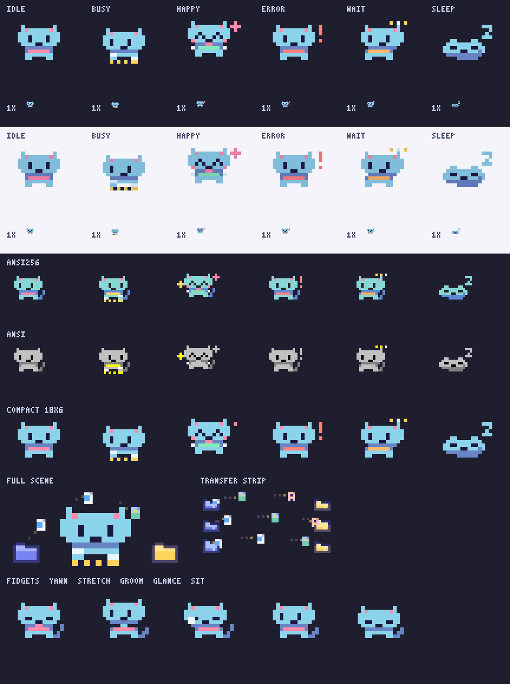

# Mascot 502Drive — 2026-10-27

Giữ đầu tròn và sáu metaball của bản gốc, hai tai, palette xanh trời → tím,
canvas 60×26, half-block `▀`/`▄` và toàn bộ chữ ký API hiện có. Không thêm dependency,
không có goroutine/timer trong mascot. CLI/TUI quyết định khi nào vẽ và dừng motion.




## Kích thước và tích hợp

- `MiniCols = 20` giữ nguyên; `MiniRows = 11` thay 9; `miniY0 = 4` thay 8.
  Crop 20×22 pixel cho đầu, thân, chân, đuôi và headroom. `MiniScale = .57` thay .44;
  đầu gốc được nén dọc và đưa lên để có chỗ cho thân, không kéo dài khuôn mặt.
- Chọn rộng 20 thay gợi ý 22–26: `internal/tui/home.go` hiện hard-code `catCols = 20`.
  Chiều cao panel được tính từ `len(catColumn())`; không cần sửa TUI để nhận 11 dòng.
  Đã `rg MiniCols/MiniRows`: chỉ renderer, preview và test dùng trực tiếp hai hằng.
- `Options{Mini: true, Compact: true}` và `CompactRows = 7` là API bổ sung cho
  terminal thấp. Vẽ lại cùng geometry ở scale 7/11 để mắt không bị blur do resize
  bitmap; crop vẫn rộng 20 cột. TUI hiện chưa chọn chế độ này tự động.
- Full vẫn 60×13 ô, crop full rộng 34, strip giữ 56×4 ô. Chỉ ASCII space và
  half-block trong output; không thêm emoji/ký tự có độ rộng mơ hồ.
- `Anim.Seed` mặc định 502, có thể đặt trước `Step` đầu. Cùng seed, mood và elapsed
  time cho cùng chuyển động. `Static`/`StaticMini` dùng seed mặc định.
- Frame cũ vẫn là snapshot độc lập sau `Step` tiếp theo. Workspace vẽ được tái dùng;
  canvas snapshot và chuỗi output vẫn cần cấp phát để giữ hợp đồng này.

## Thiết kế và motion

`body.go` giữ metaball/triangle tai, supersample mask 2× rồi lấy coverage 4 mẫu;
viền khoảng một pixel, ba mức xanh–tím, highlight trán, lòng tai/má hồng. Thân có
ngực sáng, bàn chân nhỏ, đuôi cong và khăn với chuông vàng; màu khăn chuyển theo
mood. `Options.Dark = false` làm palette đậm hơn 12% để đứng trên nền sáng.

`face.go` giữ hốc mắt tại chỗ: đồng tử, highlight, mí, mũi nhỏ, miệng hai nét cong,
râu mờ tách riêng. Gaze, pupil, biểu cảm và màu khăn được ease; blink nhanh hơn
để không bị spring nuốt mất. ANSI16/256 lấy màu gần nhất theo RGB từ palette
terminal; vẫn giữ tương phản mắt/lông, không chạy phép chuyển màu cảm nhận tốn
nhiều cấp phát mỗi frame. Palette 16 màu thực tế phụ thuộc theme terminal.

`motion.go` lấy ngẫu nhiên từ seed + bucket thời gian, không đếm frame. Idle có
saccade, blink đơn/chậm/kép và mỗi khoảng 12 giây chọn ngáp, vươn, chải má, liếc
xuống vị trí nhập ảo, hoặc ngồi thấp. Đây là điểm nhìn ảo; không đọc caret thật.
Busy theo cùng phase file với strip, nghiêng đầu, gõ chân, giọt mồ hôi. Happy hạ
thân trước nhảy, co/giãn, đầu trễ khi bật, sao nhiều màu. Error run/lông dựng/dấu !
rồi giảm dần; wait nghiêng đầu và ba chấm; sleep hạ đầu, cuộn đuôi trước chân,
thở chậm và Z trôi/mờ. Tai, đuôi, đầu/thân lệch pha.

`anim.go` giải spring tắt dần bằng công thức đóng; lấy target theo substep tối đa
1/120 giây. `dt` âm/NaN/Inf không chạy thời gian. Sau pause dài, clock đi tới trước,
chỉ tích phân quarter-second cuối, giới hạn pause một lần ở 60 giây. Procedural
phase giới hạn trong một ngày; thời gian âm/không hữu hạn của Static/Strip về 0.
Không-motion vẫn do caller gọi Static ở thời điểm cố định; test TUI xác nhận không
lập lịch animation khi `NoMotion`.

`strip.go` dùng đường cung có ease ngang, folder tách nắp/lưng và mép trước để file
thực sự đi qua cửa. Có tài liệu hai dòng mực, ảnh với đồi xanh/mặt trời, file nén
khóa kéo, đuôi sáng và sao khi tới đích. Caller Home chỉ gọi strip khi busy.

## Các vòng xem ảnh và chỉnh

1. Xem `/tmp/claude-1000/mini.png`, frame từ GIF cũ và ảnh tham chiếu 8/9/10.
   Sheet cũ bị cắt chỉ còn ba mood đầu. Mèo có mặt chiếm toàn thân; học silhouette
   và mắt rõ của chibi tham chiếu, giữ chi tiết/màu riêng của mèo.
2. Preview v1: thêm thân, scarf, mắt và AA. Thấy thân mảnh như cột, mắt nhạt,
   đuôi thành chấm rời. Tăng thân tròn, lõi tối đồng tử; vẽ toàn viền đuôi trước
   rồi toàn phần màu, tránh từng đoạn ghi đè nhau. Sleep thêm đuôi phủ bàn chân.
3. Preview v2 và filmstrip chuyển mood: thấy chóp tai bị cắt khi nhảy. Thêm test
   quét 120 thời điểm/mood, hạ ground xuống 24, chốt scale .57, đầu trễ nhịp nhảy
   .7 pixel để giữ tai trong crop. Chiều rộng vẫn vừa cột Home 20.
4. Preview v3: bản compact resize bị nhòe mắt; đổi sang vẽ geometry ở scale nhỏ
   trực tiếp. V4 đã xem lại cả compact, nền sáng/tối, six moods và strip.
5. Kiểm low-color: ANSI16 cũ mất khoảng 4.89 ms/frame. Đổi quantization RGB và
   dùng buffer byte trên stack để ghép dòng, giữ snapshot; xem lại sheet cuối
   có hàng ANSI16/256. Đã mở PNG cuối và filmstrip các frame 0/15/30/59 của GIF
   bằng công cụ đọc ảnh; nắp folder và ba loại file phân biệt được.
6. Quét crop dài hơn từ 8 lên 80 giây (1.200 thời điểm/mood) bắt thêm lỗi tai
   khi vươn vai ở giây 44; cho đầu theo thân trễ trong stretch, giữ headroom.
   Đã tái xuất và mở xem lại sheet cuối, gồm hàng fidget stretch đã sửa.

## Tái tạo preview

Đường dẫn output dùng đường dẫn tuyệt đối vì `go test` chạy từ thư mục package:

```sh
export PATH=/home/admin/D/.local/502drive-toolchains/go1.27.3/go/bin:$PATH
MASCOT_PREVIEW="$PWD/docs/assets/mascot-sheet.png" \
MASCOT_GIF="$PWD/docs/assets/mascot.gif" \
MASCOT_GIF_DIR="$PWD/docs/assets/mascot" \
go test -count=1 -run TestWritePreview ./internal/mascot
```

Các GIF riêng đều 60 frame/4.000 ms, cadence 7/6/7 centisecond cho 15 fps:
[idle](../assets/mascot/idle.gif), [busy](../assets/mascot/busy.gif),
[happy](../assets/mascot/happy.gif), [error](../assets/mascot/error.gif),
[wait](../assets/mascot/wait.gif), [sleep](../assets/mascot/sleep.gif).
[Chuyển mood](../assets/mascot/transitions.gif) dài 8 giây. Sheet gồm phóng lớn,
raster 1×, nền sáng/tối, ANSI256/16, compact, full scene, strip và đủ năm fidget.
GIF chỉ có strip khi có mood Busy trong khung.

## TUI thật qua tmux

Build `/tmp/502d`, chạy bare command trong tmux session `m`, 120×34. Dùng HTTP/SSE
fixture Python ở loopback, config/token giả trong `/tmp`, tắt tray; không đọc config,
DB hay tài khoản thật. Môi trường shell có `NO_COLOR=1`, nên đã bỏ biến này riêng
cho process kiểm màu và dùng `TERM=xterm-256color`, `COLORTERM=truecolor`.

Capture idle/busy đều: panel **13 dòng** gồm hai viền, terminal **34 dòng**, dòng
rộng nhất **108** codepoint (<120). Mèo không chạm separator/tràn panel. Busy có
strip bốn dòng; prompt/footer còn đủ chỗ. Đã kiểm bằng `tmux capture-pane -t m -p`;
capture không chứng minh màu/phông chữ terminal.

Không cần sửa layout TUI cho bản mặc định. Đề xuất cho người phụ trách TUI:
`internal/tui/home.go`, `catColumn()`: cho terminal cao 18–23 dòng dùng
`Options{Mini: true, Compact: true}` thay fallback chữ; vẫn giữ `NoMotion` và các
guard màu/ASCII. Có thể thay `catCols = 20` bằng `catCols = mascot.MiniCols` để tránh
hard-code. Chưa áp dụng vì phạm vi này không được sửa `internal/tui/*`.

## Kiểm chứng và benchmark

Go 1.27.3, Linux amd64, Intel i7-11850H. Các lệnh được yêu cầu (output nguyên văn;
những lệnh không có output đều exit 0):

```text
$ gofmt -l cmd internal
$ go vet ./...
$ go test -race -count=1 ./internal/mascot ./internal/tui
ok  	github.com/itsgiahung/502Drive/internal/mascot	11.280s
ok  	github.com/itsgiahung/502Drive/internal/tui	1.536s
$ python3 scripts/check-docs-links.py .
checked 348 relative links, 0 broken
$ go build ./...
```

Doc checker ban đầu có 333 links/0 broken. Trong lúc làm việc có ba link lỗi
ở handoff ngoài phạm vi; file đó được cập nhật tiếp trong workspace. Lần kiểm
cuối là 348 links/0 broken như trên. Không sửa file handoff. Kiểm riêng
`python3 scripts/check-docs-links.py docs/design` cũng qua: 7 links/0 broken.

`git diff --check` exit 0. Test bao phủ đối xứng nhìn thẳng, mọi mood/cùng seed,
elapsed time thay tick size, spring với dt âm/lớn/NaN/Inf, Static/Strip với t
âm/lớn/NaN/Inf, crop đầu/tai trong chuyển động, snapshot frame cũ, chuyển mood,
kích thước full/mini/compact/strip, ANSI16/256 và glyph an toàn. Test TUI hiện có
bao phủ NoMotion.

Các file ngoài mascot đang được sửa đồng thời trong workspace (power/lifecycle,
engine/state/HTTP/config và go.mod); không thuộc diff của nhiệm vụ này, đã giữ nguyên.
Không kiểm live Google/Telegram; không cần các dịch vụ này để xác minh renderer.


Benchmark bản cuối (ba lần, không race, `Step + Lines`, buffer/snapshot và output
cùng được tính; benchmark báo toàn bộ cấp phát):

| Cảnh/profile | ms/frame | B/frame | allocs/frame |
| --- | ---: | ---: | ---: |
| Mini truecolor | 0.339–0.347 | 77,298 | 147 |
| Full truecolor | 0.365–0.372 | ~80,596 | 176 |
| Mini ANSI256 | 0.421–0.430 | ~75,034 | 147 |
| Mini ANSI16 | 0.331–0.334 | ~72,604 | 147 |
| Strip + render | 0.025–0.026 | 62,087 | 41 |

Baseline trước sửa trên cùng máy: full 387,661 ns/op, 85,915 B/op,
1,066 allocs/op. Bản cuối giữ mức dưới ~1 ms và giảm cấp phát full xuống 176;
không bỏ snapshot để đổi lấy benchmark. Mask 2× chỉ quét bounding box đầu,
không quét cả canvas cho mọi subpixel. Byte buffer ghép dòng tái dùng trên stack.

Output benchmark nguyên văn:

```text
$ go test -run '^$' -bench 'Benchmark(Anim|Mini|Strip)' -benchmem -count=3 ./internal/mascot
goos: linux
goarch: amd64
pkg: github.com/itsgiahung/502Drive/internal/mascot
cpu: 11th Gen Intel(R) Core(TM) i7-11850H @ 2.50GHz
BenchmarkMiniStepAndRender-16    	    3469	    345801 ns/op	   77298 B/op	     147 allocs/op
BenchmarkMiniStepAndRender-16    	    3382	    339046 ns/op	   77298 B/op	     147 allocs/op
BenchmarkMiniStepAndRender-16    	    3490	    346516 ns/op	   77298 B/op	     147 allocs/op
BenchmarkMiniLowColor/ANSI256-16 	    2761	    430036 ns/op	   75033 B/op	     147 allocs/op
BenchmarkMiniLowColor/ANSI256-16 	    2628	    422683 ns/op	   75028 B/op	     147 allocs/op
BenchmarkMiniLowColor/ANSI256-16 	    2823	    421329 ns/op	   75040 B/op	     147 allocs/op
BenchmarkMiniLowColor/ANSI-16    	    3560	    333979 ns/op	   72603 B/op	     147 allocs/op
BenchmarkMiniLowColor/ANSI-16    	    3357	    331096 ns/op	   72605 B/op	     147 allocs/op
BenchmarkMiniLowColor/ANSI-16    	    3410	    332681 ns/op	   72604 B/op	     147 allocs/op
BenchmarkStripAndRender-16       	   44564	     25584 ns/op	   62087 B/op	      41 allocs/op
BenchmarkStripAndRender-16       	   46808	     25428 ns/op	   62087 B/op	      41 allocs/op
BenchmarkStripAndRender-16       	   46731	     25353 ns/op	   62087 B/op	      41 allocs/op
BenchmarkAnimStepAndRender-16    	    3194	    368336 ns/op	   80595 B/op	     176 allocs/op
BenchmarkAnimStepAndRender-16    	    2974	    365412 ns/op	   80597 B/op	     176 allocs/op
BenchmarkAnimStepAndRender-16    	    3176	    372385 ns/op	   80597 B/op	     176 allocs/op
PASS
ok  	github.com/itsgiahung/502Drive/internal/mascot	18.722s
```

Bộ race toàn repo **chưa qua**. Lần chạy cuối fail trong daemon lifecycle ngoài
phạm vi mascot; không sửa/bỏ qua test này. Output nguyên văn:

```text
$ go test -race -count=1 ./...
?   	github.com/itsgiahung/502Drive/cmd/502drive	[no test files]
?   	github.com/itsgiahung/502Drive/cmd/502drive-tray	[no test files]
ok  	github.com/itsgiahung/502Drive/internal/app	3.040s
ok  	github.com/itsgiahung/502Drive/internal/cli	14.765s
ok  	github.com/itsgiahung/502Drive/internal/config	1.027s
--- FAIL: TestLifecycleResumeProbesWithBackoffThenOpensTheGate (0.17s)
    lifecycle_test.go:184: the engine was not woken after the probe
FAIL
FAIL	github.com/itsgiahung/502Drive/internal/daemon	6.669s
ok  	github.com/itsgiahung/502Drive/internal/drive	1.434s
?   	github.com/itsgiahung/502Drive/internal/drive/drivetest	[no test files]
ok  	github.com/itsgiahung/502Drive/internal/engine	17.492s
ok  	github.com/itsgiahung/502Drive/internal/httpapi	10.867s
ok  	github.com/itsgiahung/502Drive/internal/i18n	1.026s
ok  	github.com/itsgiahung/502Drive/internal/maintenance	4.028s
ok  	github.com/itsgiahung/502Drive/internal/mascot	11.019s
ok  	github.com/itsgiahung/502Drive/internal/power	1.140s
ok  	github.com/itsgiahung/502Drive/internal/schedule	1.043s
ok  	github.com/itsgiahung/502Drive/internal/state	1.613s
ok  	github.com/itsgiahung/502Drive/internal/telegram	12.663s
ok  	github.com/itsgiahung/502Drive/internal/tray	6.136s
ok  	github.com/itsgiahung/502Drive/internal/tui	1.654s
ok  	github.com/itsgiahung/502Drive/internal/update	1.042s
FAIL
```

Lần chạy trước còn gặp `internal/engine/TestUnreachableReleasesWithoutPenaltyAndReportsIt`:
`offline_test.go:123: copy calls = 2, want exactly the failed one`.
Chạy riêng `go test -race -count=3 -run
'^TestUnreachableReleasesWithoutPenaltyAndReportsIt$' ./internal/engine` cũng đã exit 1:
`offline_test.go:119: transport failure left item in executing` (fixture giả).
Ở lần chạy cuối engine đã qua (17.492s). Không sửa engine, state hay daemon;
workspace đang được cập nhật đồng thời ở các phần này.

## Capture tmux với fixture giả

Đã build bằng `go build -o /tmp/502d ./cmd/502drive`. Cấu hình HTTP fixture qua
`DRIVE502_CONFIG=/tmp/502drive-mascot-tui/config.json`,
`DRIVE502_NO_TRAY=1`, bỏ `NO_COLOR` chỉ trong process kiểm. Chạy binary thật:

```sh
tmux new-session -d -s m -x 120 -y 34 'env -u NO_COLOR DRIVE502_CONFIG=/tmp/502drive-mascot-tui/config.json DRIVE502_NO_TRAY=1 TERM=xterm-256color COLORTERM=truecolor /tmp/502d --color always'
tmux capture-pane -t m -p
```

Idle, output nguyên văn:

```text
╭─ 502Drive · ● trực tiếp ─────────────────────────────────────────────────────────────────────────────────╮
│                      │                                      │                                            │
│      ▀▄     ▄▀       │                                      │                                            │
│      ▀▀▀▄▄▄▀▀▀▀      │                                      │                                            │
│    ▄▀▀▀▀▀▀▀▀▀▀▀▀▄    │ Chào buổi sáng! Sẵn sàng copy.       │                                            │
│   ▄▀▀▀▀▀▀▀▀▀▀▀▀▀▀▀   │                                      │ Bắt đầu                                    │
│   ▀▀▀▀▀▀▀▀▀▀▀▀▀▀▀▀   │ Google: Demo account                 │ Dán link Drive vào ô dưới, nhấn Enter để … │
│    ▀▀▀▀▀▀▀▀▀▀▀▀▀▀    │ Thư mục đích: Demo destination       │ Gõ / xem lệnh · nhấn 1–7 để chuyển màn     │
│      ▄▀▀▀▀▀▀▀▀▄▄▀▀▀▄ │ 0 đang chạy · 0 đang chờ · 0 cần xử… │                                            │
│      ▀▀▀▀▀▀▀▀▀▀▀▀▀▀▀ │                                      │                                            │
│      ▀▀▀▀▀▀▀▀▀▀▀     │                                      │                                            │
│      ▀▀▀▀▀▀▀▀▀▄      │                                      │                                            │
╰──────────────────────────────────────────────────────────────────────────────────────────────────────────╯

  Hoạt động gần đây
  Chưa có công việc nào


╭──────────────────────────────────────────────────────────────────────────────────────────────────────────╮
│ ❯ Dán link Drive, hoặc gõ / để xem lệnh                                                                  │
╰──────────────────────────────────────────────────────────────────────────────────────────────────────────╯

/ lệnh · 1–7 chuyển màn · c copy · l đăng nhập · ? trợ giúp · q thoát
```

Busy, output nguyên văn:

```text
╭─ 502Drive · ● trực tiếp ─────────────────────────────────────────────────────────────────────────────────╮
│       ▄              │                                      │                                            │
│      ▄▀▀▄   ▄▀▀      │                                      │                                            │
│     ▄▀▀▀▀▀▀▀▀▀▀ ▄    │                                      │                                            │
│    ▀▀▀▀▀▀▀▀▀▀▀▀▀▀    │ Chào buổi sáng! Sẵn sàng copy.       │                                            │
│   ▀▀▀▀▀▀▀▀▀▀▀▀▀▀▀    │                                      │ Bắt đầu                                    │
│   ▀▀▀▀▀▀▀▀▀▀▀▀▀▀▀▀   │ Google: Demo account                 │ Dán link Drive vào ô dưới, nhấn Enter để … │
│     ▀▀▀▀▀▀▀▀▀▀▀▀     │ Thư mục đích: Demo destination       │ Gõ / xem lệnh · nhấn 1–7 để chuyển màn     │
│      ▄▀▀▀▀▀▀▀▀▄▄▄    │ 1 đang chạy · 0 đang chờ · 0 cần xử… │                                            │
│      ▀▀▀▀▀▀▀▀▀▀▀▀▀   │                                      │                                            │
│      ▀▀▀▀▀▀▀▀▀▀▀▀    │                                      │                                            │
│      ▄▀▀▀▀▀▀▀▀▄      │                                      │                                            │
╰──────────────────────────────────────────────────────────────────────────────────────────────────────────╯

            ▄▄▄          ▄ ▄  ▄ ▀▀▀
   ▄▄   ▄▄▀ ▀▀▀                 ▀▀▀          ▀▀ ▄▀▀▀▄▄▄▄▄
   ▀▀▀▀▀▀▀  ▀▀▀                                  ▀▀▀▀▀▀▀▀
   ▀▀▀▀▀▀▀                                        ▀▀▀▀▀▀▀
  Đang copy 0 / 0 mục
  Demo copy  mục: 0 xong · chưa rõ tổng

  Hoạt động gần đây
  ⠋ Demo copy                        RUNNING RUNNING


╭──────────────────────────────────────────────────────────────────────────────────────────────────────────╮
│ ❯ Dán link Drive, hoặc gõ / để xem lệnh                                                                  │
╰──────────────────────────────────────────────────────────────────────────────────────────────────────────╯

/ lệnh · 1–7 chuyển màn · c copy · l đăng nhập · ? trợ giúp · q thoát
```

Đã thoát client bằng `q` và đóng HTTP fixture sau khi capture; không để daemon
hay tray thử nghiệm chạy ngầm. Chưa xem màu trong terminal GUI thật với nhiều
font/theme, chưa kiểm hành vi live Google/Telegram. GIF/PNG là mô phỏng renderer,
không chứng minh mọi terminal sẽ hiển thị cùng màu và tỉ lệ ô.
